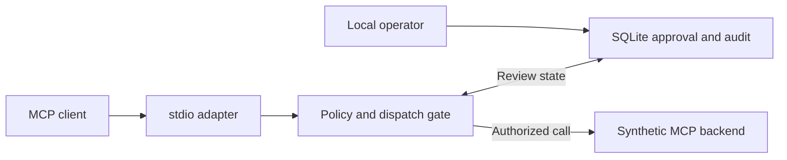

# Design and framework integration

## Execution boundary

The guardrail terminates MCP at a narrow stdio façade. It exposes fixed tool definitions rather than forwarding arbitrary messages, upstream tool metadata, resources, or prompts. The official SDK handles MCP framing and lifecycle. Requests that reach the tool handler are checked against fixed JSON Schemas and explicit allow, deny, or approval rules. SDK-level protocol errors and application-level denials have different meanings. The application reports policy denials as MCP tool results with `isError: true`.



The gate records authorization before dispatch. Operator review and forwarding are separate steps. After approval, only a retry from the same running gate with identical validated arguments can consume the grant. Audit events distinguish permission to dispatch, a backend response, and an unknown outcome.

## Six Mottos and research scope

| Motto | Reference implementation treatment |
| --- | --- |
| Relieve suffering | A synthetic incident scenario for evaluating how safe rules affect service access |
| Create more jobs and opportunities | A workflow evaluation question for later user studies |
| Serve where lives are at risk | A simulated response scenario, with no emergency priority override |
| Apply No-Harm Principles | Deny irreversible deletion, unknown tools, and invalid arguments before dispatch |
| Protect dignity and choice | Show an exact proposed action to the operator and require a single-use approval |
| Care for Earth and future generations | A future measurement exercise using verified workload telemetry |

A future harm-floor model needs defined outcomes, evidence, uncertainty handling, and a calibrated threshold. Vulnerability-weighted utility belongs in comparative simulations over actions that have already passed hard rules. The reference gate runs fixed policy and uses no embeddings or welfare scores.

## Operator observability

The stdio adapter attaches a request ID to audited tool responses. The operator can correlate that ID with local audit events and approval decisions. See [operator observability](observability.md) and [framework review](framework-review.md) for the integration decisions.

## Framework adapter contract

`Guardrail(store, principal, dispatch)` is transport-independent Python code. The adapter supplies a trusted launcher identity and an async function that executes a validated tool call. Invoke `await gate.call(name, arguments)` at the point that actually controls execution. Map `Outcome.status` to the host interface. Retain the same gate instance through review and retry. Ensure the host has no parallel path to the underlying action.

```python
from cai_guardrail.core import Guardrail
from cai_guardrail.state import Store

async def mock_dispatch(name, arguments):
    return {"tool": name, "synthetic": True}

async def run():
    gate = Guardrail(Store(".demo-state"), "local-demo", mock_dispatch)
    return await gate.call("read_incident", {"incident_id": "INC-001"})
```

For LangChain, LlamaIndex, or CrewAI, begin with a tool wrapper that calls this gate before invoking the underlying tool. Verify that framework retries and parallel calls cannot execute the wrapped action independently. A callback that only observes a completed call cannot enforce the policy. A future React component can present review status while a trusted backend retains authority. The framework wrappers and TypeScript SDK are roadmap items.

For remote MCP work, first define an identity and authorization model, use the target revision's Streamable HTTP binding, and test client and server interoperability. Keep the tested protocol revision and SDK version in release notes.

- [MCP lifecycle for 2025-11-25](https://modelcontextprotocol.io/specification/2025-11-25/basic/lifecycle)
- [MCP tools for 2025-11-25](https://modelcontextprotocol.io/specification/2025-11-25/server/tools)
- [MCP transports for 2025-11-25](https://modelcontextprotocol.io/specification/2025-11-25/basic/transports)
